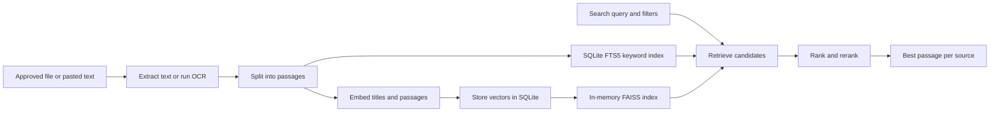

# ECHO

ECHO is a local-first search engine for a personal archive, built as an undergraduate Avishkar project in Engineering and Technology. Import a document, screenshot, note, or saved webpage, then search for the passage you remember. Each account has its own library on the computer running ECHO.

## Clone and run on Windows

Use **Git**, **64-bit Python 3.13**, and **Node.js 22.12 or later with npm**. First-time setup installs dependencies and downloads about 183 MB of English embedding and reranking models. Importing and searching then run on the ECHO host's CPU. Install Tesseract with English language data on the host if you want to index screenshots or scanned PDFs.

**1. Check the tools.** Open PowerShell or the PowerShell terminal in VS Code.

```powershell
git --version
python --version
node --version
npm.cmd --version
```

**2. Clone the repository.** Run these commands from the folder where you keep projects.

```powershell
git clone https://github.com/codewithvikas96-ui/ECHO.git
cd ECHO
```

**3. Install and start ECHO.** From the cloned folder, run the setup script.

```powershell
.\start.ps1 -Setup
```

The script creates `.venv`, installs the Python requirements, downloads both models and their tokenizers, installs the locked frontend dependencies, builds the React app, and starts the server. Leave that terminal open. When Uvicorn reports that it is running, open [ECHO on your PC](http://127.0.0.1:8000).

If Windows has several Python versions and `python --version` points to a different one, run `py -3.13 -m venv .venv` from the clone before starting setup. The script will use that environment.

**4. Create your account.** Choose **Create an account**, enter a username and a password of at least 12 characters, and open your library. A fresh clone starts with an empty library.

**5. Try a search.** Choose **Load sample archive**, select **Context-aware**, and search for `How can I remember what I study for longer?`. Open a result such as **Sleep and memory consolidation** to read the matched passage.

### Start, stop, or change ports

On later runs, start ECHO from the repository folder with `.\start.ps1`. Press **Ctrl+C** in its terminal to stop it. To use a different local port, run `.\start.ps1 -Port 8010` and open [localhost on port 8010](http://127.0.0.1:8010).

Check the default server from a second PowerShell terminal.

```powershell
Invoke-RestMethod http://127.0.0.1:8000/api/health
```

`model_ready` reports whether the embedding model is installed. `reranker_ready` reports whether the second model is installed. `ocr_available` reports whether ECHO found the Tesseract executable.

### Run on macOS or Linux

From a clone of the repository, the equivalent manual setup uses the same Python and Node.js versions. Run the following in a shell with Python 3.13 available as `python3.13`.

```bash
python3.13 -m venv .venv
source .venv/bin/activate
python -m pip install -r requirements.txt
python -m echo.model_setup
npm ci
npm run build
python -m uvicorn echo.server:app --host 127.0.0.1 --port 8000 --no-access-log
```

Open the localhost address and follow the account and first-search steps above. Windows is the platform used to verify this project.

## Use your own sources

### Index files from device storage

Open **Settings → Index device storage**, or choose **Add source → Upload files → Index device storage**. On a PC, open ECHO through localhost. On a phone or another computer, use a trusted HTTPS connection to the host. [Phone setup](docs/phone.md)

1. Choose individual files or images, or choose a folder to include its subfolders. Browsers that lack folder selection can use the file picker.
2. Review the relative paths, formats, sizes and skipped-file reasons. The selection starts empty. Check individual entries or select eligible documents or images as a group. Folder paths stay in the browser. If the phone's file picker cannot select a whole folder, compress it and choose **Choose ZIP**. ECHO lists the ZIP's contents locally and extracts only approved files for indexing.
3. Check the account, destination host, count and byte total. **Allow and index selected files** sends each approved file to that host for parsing or OCR. ECHO stores its filename, extracted text, metadata and search vectors in the account database. This operation retains no new original file; an existing copy from a previous ordinary upload keeps its original retention state.
4. Use **Stop after current file** to pause the batch. Successful items stay searchable. You can retry the remaining items while the dialog stays open. Closing releases the selection. Returning later requires using the picker again. Delete an indexed source in **Library → source details → Remove source**. The file on the device stays intact.

The picker grants one-time, read-only access to the selection. ECHO does not watch folders in the background. Screenshots are searchable by recognized text. The review list is paginated and files upload sequentially; the current 16 MiB per-file limit applies. FAISS uses an exact inner-product index over normalized vectors and holds the index in host memory. Large-library capacity depends on the host and the number of passages per file.

The host processes file contents and its administrator can access the database on disk. Choose a host you trust. Ordinary **Upload files** also keeps downloadable originals for supported formats.

### Add individual sources

| Source | How to add it |
| --- | --- |
| PDF, TXT, Markdown, Word (.docx) | Choose **Add source → Upload files**. Select one or several files, then choose **Add to library**. ECHO extracts selectable PDF text directly and uses local OCR on scanned pages with little readable text. |
| Screenshot (PNG, JPEG, WebP) | Install Tesseract with English language data on the host PC. Check **Settings → PDF and screenshot OCR**, then upload the image and search for a visible phrase. |
| Saved webpage | Upload a saved HTML/HTM file, or use **Save a webpage** to paste the text and optionally record its URL. |
| Note | Choose **Write a note**, give it a title and some text, then add it to the library. |

Each uploaded file can be up to 16 MiB. Use the source-type and date filters to narrow a search. Open **Library** to inspect indexed passages by page, retrieve a retained original, or remove a source.

**Update an existing PDF.** Check **Settings → PDF and screenshot OCR** for Tesseract availability on the ECHO host. Open **Library**, select the PDF, and choose **Refresh PDF index**. If you used device storage indexing, choose the same PDF again and click **Allow and refresh PDF index**. ECHO replaces the passages in that library entry and keeps its original retention setting. Try **Keyword** with a distinctive word on the page, then open the result to check the passage and page number. For a long scan that times out, split it into smaller PDFs.

### Choose a search mode

| Mode | When to use it |
| --- | --- |
| **Context-aware** | Start here for a remembered idea. It combines passage and title meaning with keyword matches and source metadata. A request such as `find my note about ventilation` can favor notes. |
| **Semantic** | Use a paraphrase when you forget the original wording. FAISS retrieves title and passage embeddings, and the local reranker compares the strongest candidate passages directly with your query. Exact passage words and phrases also match. |
| **Keyword** | Use distinctive words, an exact filename, or a quoted phrase such as `"cross ventilation"`. |

Context-aware and Keyword modes prioritize an exact filename or title and respect quoted phrases. Each source appears once with its best-scoring passage. The **Title meaning** label indicates a semantic match driven by the title.

## Access from a phone

Connect the phone and the host PC to the same trusted Wi-Fi. From PowerShell in the project folder, enter the PC’s Wi-Fi IPv4 address when prompted.

```powershell
$echoAddress = Read-Host "PC Wi-Fi IPv4 address"
.\.venv\Scripts\python.exe -m echo.phone $echoAddress --port 8001
```

Open the HTTP URL printed in the terminal. First use the gateway credentials shown on the PC, then sign in to your personal ECHO account. Using the same account on the PC and phone opens the same library. Sign out through **Settings** on a shared device. [Phone setup and port troubleshooting](docs/phone.md)

## How ECHO works

The React and TypeScript frontend handles sign-in, source selection, and results. FastAPI authenticates each request and opens the signed-in user's SQLite archive. On a phone, the browser sends approved files and search requests to the PC running ECHO. Extraction, OCR, embedding, and ranking all run on that host.



### How indexing works

1. **Receive a source.** For a device-storage import, the browser lists the files it can read and sends each approved file by basename. For an ordinary upload, ECHO can also keep a downloadable copy of the file. For a note or saved webpage, ECHO can index text pasted into the browser.
2. **Extract the text.** ECHO reads PDF text page by page with pypdf. When a page appears scanned or its text appears unreadable, ECHO can render it with PDFium and read the image with Tesseract. Screenshots go through Tesseract directly. ECHO also extracts Word paragraphs, decodes TXT and Markdown, and reads the main text of saved HTML.
3. **Split the text into passages.** ECHO normalizes whitespace and uses the embedding tokenizer's offsets to cut long sections into passages of up to 192 model tokens. Consecutive passages share 32 tokens so a phrase near a boundary can still be found. Each PDF passage keeps its page number.
4. **Build a keyword index.** SQLite FTS5 indexes each passage together with its source title. Its tokenizer matches common inflections, and BM25 scores keyword matches. Source type, filename, date, and any retained original live in the account's SQLite database.
5. **Build a vector index.** The English `all-MiniLM-L6-v2` model runs through ONNX Runtime. ECHO averages its token-level outputs and normalizes each example into a 384-dimensional vector. It stores vectors for both the passages and the source title in SQLite. On the first semantic search, FAISS loads the account's vectors into an exact inner-product index. With unit-length vectors, inner product measures cosine similarity.
6. **Keep both indexes current.** ECHO fingerprints the extracted content together with the source type and URL to recognize duplicate imports. Adding, removing, or refreshing a source updates SQLite in a transaction and advances the archive revision. A later semantic search detects that revision and rebuilds the account's in-memory FAISS index from the updated vectors. **Refresh PDF index** replaces the passages of a PDF in the same library entry.

### How search works

1. **Read the query and filters.** ECHO normalizes the query and applies any selected source-type or date filters within the signed-in account. Keyword and Context-aware modes treat quoted phrases as required evidence. Context-aware mode can also favor a type mentioned in the query, such as `my note`.
2. **Retrieve candidates.** Keyword mode looks up FTS5 matches and name matches. Semantic and Context-aware modes also embed the query and use FAISS to retrieve nearby title and passage vectors. For a candidate passage, semantic scoring uses the larger of the passage similarity and a blend of 80% title similarity and 20% passage similarity. This helps a descriptive title surface a file whose body contains boilerplate.
3. **Rank the strongest evidence.** Exact names and exact passage words or phrases receive a ranking boost. Context-aware search also weighs BM25 and source metadata. When the reranker is installed, Semantic and Context-aware search can compare up to 24 shortlisted query–passage pairs using a local MiniLM cross-encoder. This helps distinguish passages that share similar words but answer different questions.
4. **Show one result per source.** ECHO keeps the best-scoring passage for each source and shows an excerpt, its match reason, and its PDF page number when available. For example, searching `forget gate` can take you directly to the page containing that phrase. Open the result to read the passage in context or open a retained PDF at that page.

### Storage and upgrades

The default data folder is `.echo/`. It contains the account database, the individual archives under `.echo/users/`, the embedding model under `.echo/model/`, and the reranker under `.echo/reranker/`. ECHO uses account sessions to keep libraries separate. The host's administrator can read files in this directory. The repository ignores the data folder, local gateway passwords, and certificate keys.

For an existing checkout, stop ECHO, run `git pull --ff-only`, then `.\start.ps1 -Setup` to apply code, dependency, and frontend updates. The first Semantic or Context-aware search in an older account computes its missing title vectors. This can take longer on a large library. Existing passages and originals are preserved. Pre-account installations retain their unassigned archive in `.echo/archive.sqlite3`; users can import their own originals into their personal accounts.

## Evaluate and develop

Choose **Evaluation → Run benchmark** to compare all three search modes on the same 12 authored sources and 12 labelled queries in a temporary archive. The report includes Precision@3, Recall@3, MRR@3, nDCG@3, and latency. Run the same benchmark from PowerShell with `.\.venv\Scripts\python.exe -m echo.demo`.

| Retrieval check | Result |
| --- | --- |
| Six title-paraphrase queries against documents with generic bodies | Correct source ranked first in 6/6 queries in both Semantic and Context-aware modes, up from 0/6 with passage-only embeddings. Three unrelated queries still returned zero results in both modes. |
| Built-in benchmark, Recall@3 | Keyword 87.5%, Semantic 100%, Context-aware 100%, before and after the title change. |

These are small, authored evaluations. The title cases exercise a specific failure mode; OCR quality, language, archive size, and the kinds of questions people ask can change real-world results.

Install the test dependencies after first-time setup and run the suite.

```powershell
.\.venv\Scripts\python.exe -m pip install -r requirements-test.txt
.\.venv\Scripts\python.exe -m unittest discover -s tests -v
```

For frontend development, run `.\start.ps1` on port 8000, then `npm.cmd run dev` in a second terminal and open the Vite URL it prints. Vite proxies API calls to the backend on port 8000. Use `npm.cmd run build` to type-check and rebuild the production UI. [Local API documentation](http://127.0.0.1:8000/docs)

| Project path | Contents |
| --- | --- |
| `src/` | React interface, account screens, API client, and styles |
| `echo/server.py`, `echo/accounts.py` | FastAPI routes, account sessions, and access to private archives |
| `echo/extract.py`, `echo/ocr.py` | Document parsing, screenshot recognition, and passage extraction |
| `echo/embeddings.py`, `echo/archive.py` | Local inference, storage, indexing, and ranking |
| `echo/demo.py`, `tests/` | Sample corpus, retrieval evaluation, and regression tests |

### Troubleshooting

| Symptom | What to do |
| --- | --- |
| Windows reports error 10048 | Another process is listening on the port. Choose a different port with `.\start.ps1 -Port 8010`, or stop the earlier ECHO terminal with Ctrl+C. |
| The model is missing or setup was interrupted | From the clone, rerun `.\start.ps1 -Setup` with internet access. To fetch just the model after installing Python dependencies, run `.\.venv\Scripts\python.exe -m echo.model_setup`. |
| FAISS is ready and the reranker needs setup | Run `.\.venv\Scripts\python.exe -m echo.model_setup` in the shell you use to launch ECHO. It downloads any missing model files. Restart ECHO and reload the browser. |
| PDF or screenshot OCR is unavailable | Install Tesseract with English language data on the host, make its executable available on PATH or in its standard Windows install folder, then restart ECHO. Use **Refresh PDF index** for previously imported PDFs. |
| A search returns no results | Open **Library** under the correct account and confirm the source was indexed. Clear any date or type filters. For an image, inspect the extracted passage to see which words OCR recognized. |

The dashboard ripple artwork was created with ImageGen for ECHO.
